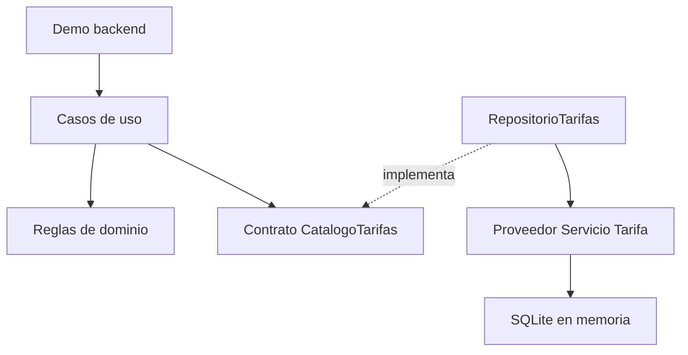

# Arquitectura del avance MEP

## Flujo de lectura y calculo

La demostracion invoca casos de uso de `src/servicios`. Estos reciben un catalogo
por parametro mediante el contrato `CatalogoTarifas`; no abren conexiones.
El adaptador `RepositorioTarifas` usa SQLAlchemy para leer el esquema de Braham
y entrega diccionarios con valores simples y Decimal.

Las reglas de `src/dominio` filtran condiciones comerciales, ordenan ofertas,
validan precio/cantidad y suman costos. No importan SQLAlchemy, SQLite ni modelos ORM.
`src/ui` conserva la estructura inicial; no contiene una aplicacion web final.

## Separacion de aportes

- Braham: modelos, fixture, siete pruebas ORM y ERD.
- Continuacion backend de Yosahandy: filtrado, comparacion, repositorio de lectura,
  cotizacion, calculo Decimal y 36 nuevas pruebas.
- El ZIP base aporta 29 pruebas anteriores. La verificacion integrada suma 72.

El esquema implementa dos relaciones 1:N: Proveedor-Servicio y Servicio-Tarifa.
No se agrega N:M porque este catalogo no necesita compartir un servicio entre proveedores.
La cascada es una operacion del ORM; no se configuro ON DELETE CASCADE en el motor.

## Limites

Las tarifas son referenciales. No se convierten monedas, no se aplican descuentos
automaticos y no se confirma disponibilidad. El campo descuento_pct se conserva
en el esquema para una regla comercial futura. La comparacion exige moneda,
categoria y temporada iguales y considera pasajeros, vigencia y estados activos.
La unidad de cobro debe ser comparable entre las alternativas seleccionadas.

La cotizacion devuelve Decimal; la funcion original calcular_costo_total sigue
devolviendo float por compatibilidad. No se guarda una cotizacion ni una solicitud
porque esas entidades aun no pertenecen al esquema de persistencia de este avance.
